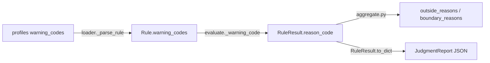

# 告警码（warning_codes）参考

本文件是 ODD 判决告警码的**唯一权威文档**。码表部分（第 3 节）由
[`scripts/gen_warning_codes_doc.py`](../scripts/gen_warning_codes_doc.py) 从
[`profiles/`](../profiles/) 自动生成，**请勿手工编辑标记区间内的内容**。

## 1. 概述：两个命名空间

判决结果 [`RuleResult.reason_code`](../judge/odd_judge/core/types.py:128) 会混用两套码值，消费方须区分：

| 命名空间 | 来源 | 形如 | 含义 |
|---|---|---|---|
| **profile 告警码** | [`profiles/*.json`](../profiles/) 各元素的 `warning_codes` 字段 | `ENV-VIS-001`、`ODD-GEO-RADIUS-NEAR` | 该元素越界/临界时的业务告警码，可对外分发 |
| **引擎码** | [`judge/odd_judge/core/evaluate.py`](../judge/odd_judge/core/evaluate.py) 硬编码 | `UNDEFINED-STRICT`、`CONDITIONAL-SKIP` | 规则未正常评估时的内部原因码（见第 5 节） |

每个元素可配两个告警码键（[`_warning_code()`](../judge/odd_judge/core/evaluate.py:229) 只消费这两个键，
[`validate_profile_dict()`](../judge/odd_judge/config/schema.py:145) 会拒绝其他键名）：

- `outside`：判决为 **OUTSIDE**（域外）时输出；
- `boundary`：判决为 **BOUNDARY**（落入边界带）时输出；
  **未配置 `boundary` 的元素在 BOUNDARY 状态下回落输出 `outside` 码**
  （[`evaluate.py:234`](../judge/odd_judge/core/evaluate.py:234)），消费方不能仅凭码值后缀判断严重度。

## 2. 命名规范

格式：`<域前缀>-<主题>[-<主题>...]-<序号或 NEAR>`，校验正则
`^[A-Z][A-Z0-9]*(-[A-Z0-9]+)+$`（[`schema.py`](../judge/odd_judge/config/schema.py) 强制）。

| 前缀 | 含义域 | 示例 |
|---|---|---|
| `ODD-` | ODD 判定通用（道路/几何/速度/临时设施） | `ODD-GEO-RADIUS-001` |
| `SCN-` | 场景（标线/交叉/结构物/标志） | `SCN-LANE-01` |
| `ENV-` | 天气环境（能见度/雨/雪/雾） | `ENV-VIS-NEAR` |
| `ILL-` | 光照（照度/眩光） | `ILL-LUX-001` |
| `DYN-` | 动态目标物（VRU/动物/静态障碍） | `DYN-VRU-01` |
| `ODC-` | 驾乘人员 / 系统状态 | `ODC-BELT-001` |
| `PER-` | 传感器 / 感知质量 | `PER-CAM-CONF-NEAR` |
| `ENT-` | 企业扩展（override 示例） | `ENT-TUNNEL-NEAR` |

后缀约定：

- **`-NEAR`**：`boundary` 码专用后缀，表示"临近边界带"预警；
- **数字序号**：`outside` 码。序号风格两位/三位并存（`SCN-LANE-01` / `ODD-ROAD-TYPE-001`），
  且**存在跳号**（如 `ENV-RAIN-002`、`ENV-FOG-02`、`DYN-VRU-03`）——序号沿用
  BYD TJP ODC 表 B.1–B.3 的源表条目号（出处见
  [`docs/training/README.md`](training/README.md)），跳号是正常的，不要"补号"。

唯一性约束：**同一 profile 内每个码值（`boundary` 与 `outside` 统一计入）只能出现一次**，
由 [`check_warning_code_duplicates()`](../judge/odd_judge/config/schema.py) 在加载与 `validate` 时强制。
历史上 `PER-CONF-NEAR` 曾同时挂在摄像头/激光雷达置信度两个元素上（无法归因到传感器），
已重命名为 `PER-CAM-CONF-NEAR` / `PER-LIDAR-CONF-NEAR`。

## 3. 码表（自动生成）

<!-- AUTO-GEN:BEGIN -->
### `profiles/byd_tjp.json` — profile_id: byd_tjp

| 告警码 | 触发状态 | element_id | label_zh | 触发条件 | message_zh |
|---|---|---|---|---|---|
| `ODD-ROAD-TYPE-001` | OUTSIDE（域外） | `ODC.1.1.1.road_type` | 道路类型 | ∈ {expressway_main, highway_main} ∉ {urban_arterial, urban_minor, urban_branch, rural_road, highway_l1, highway_l2, highway_l3, highway_l4, other_road} | 道路类型须为高速/快速路主路 |
| `ODD-AREA-001` | OUTSIDE（域外） | `ODC.1.1.2.road_area` | 运行区域 | expect=true | — |
| `ODD-GEO-RADIUS-001` | OUTSIDE（域外） | `ODC.1.2.1.curve_radius` | 曲率半径 | >= 200，边界带 ±20 | — |
| `ODD-GEO-RADIUS-NEAR` | BOUNDARY（边界带） | `ODC.1.2.1.curve_radius` | 曲率半径 | >= 200，边界带 ±20 | — |
| `ODD-GEO-GRADE-001` | OUTSIDE（域外） | `ODC.1.2.2.longitudinal_grade` | 纵坡 | between [-9, 9]，边界带 ±0.9 | — |
| `ODD-GEO-GRADE-NEAR` | BOUNDARY（边界带） | `ODC.1.2.2.longitudinal_grade` | 纵坡 | between [-9, 9]，边界带 ±0.9 | — |
| `ODD-GEO-SLOPE-001` | OUTSIDE（域外） | `ODC.1.2.3.cross_slope` | 横坡/超高 | between [-2, 2]，边界带 ±0.2 | — |
| `ODD-GEO-SLOPE-NEAR` | BOUNDARY（边界带） | `ODC.1.2.3.cross_slope` | 横坡/超高 | between [-2, 2]，边界带 ±0.2 | — |
| `ODD-LANE-WIDTH-001` | OUTSIDE（域外） | `ODC.1.2.4.lane_width` | 车道宽度 | between [2.5, 5.5]，边界带 ±0.2 | — |
| `ODD-LANE-WIDTH-NEAR` | BOUNDARY（边界带） | `ODC.1.2.4.lane_width` | 车道宽度 | between [2.5, 5.5]，边界带 ±0.2 | — |
| `SCN-LANE-01` | OUTSIDE（域外） | `ODC.1.3.1.marking_clear` | 标线清晰 | expect=true | — |
| `SCN-LANE-03` | OUTSIDE（域外） | `ODC.1.3.2.no_marking` | 无道路交通标线 | expect=true | — |
| `SCN-JCT-01` | OUTSIDE（域外） | `ODC.1.4.1.intersection` | 平面交叉路口 | expect=true | — |
| `SCN-JCT-02` | OUTSIDE（域外） | `ODC.1.4.2.roundabout` | 环岛 | expect=true | — |
| `ODD-JCT-RAMP-001` | OUTSIDE（域外） | `ODC.1.4.3.ramp` | 匝道 | expect=true | — |
| `SCN-STR-03` | OUTSIDE（域外） | `ODC.1.4.4.toll_station` | 收费站 | expect=true | — |
| `SCN-STR-04` | OUTSIDE（域外） | `ODC.1.4.5.railway_crossing` | 铁路交叉 | expect=true | — |
| `SCN-SIGN-04` | OUTSIDE（域外） | `ODC.1.4.6.construction` | 道路施工 | expect=true | — |
| `ODD-TEMP-ACC-001` | OUTSIDE（域外） | `ODC.1.4.7.accident_scene` | 事故现场 | expect=true | — |
| `ODD-TEMP-CTRL-001` | OUTSIDE（域外） | `ODC.1.4.8.traffic_control` | 交通管制 | expect=true | — |
| `ODD-SPD-001` | OUTSIDE（域外） | `ODC.2.1.1.speed` | 运行速度 | between [0, 80]，边界带 ±3 | — |
| `ODD-SPD-NEAR` | BOUNDARY（边界带） | `ODC.2.1.1.speed` | 运行速度 | between [0, 80]，边界带 ±3 | — |
| `ODD-SPD-ACT-001` | OUTSIDE（域外） | `ODC.2.1.2.activation_speed` | 激活速度 | between [0, 80]，边界带 ±3 | — |
| `ODD-SPD-ACT-NEAR` | BOUNDARY（边界带） | `ODC.2.1.2.activation_speed` | 激活速度 | between [0, 80]，边界带 ±3 | — |
| `ODD-ACC-LAT-001` | OUTSIDE（域外） | `ODC.2.1.3.lat_accel` | 横向加速度 | between [-2, 2]，边界带 ±0.2 | — |
| `ODD-ACC-LAT-NEAR` | BOUNDARY（边界带） | `ODC.2.1.3.lat_accel` | 横向加速度 | between [-2, 2]，边界带 ±0.2 | — |
| `ODD-ACC-LON-001` | OUTSIDE（域外） | `ODC.2.1.4.lon_accel` | 纵向加速度 | between [-10, 2]，边界带 ±0.5 | — |
| `ODD-ACC-LON-NEAR` | BOUNDARY（边界带） | `ODC.2.1.4.lon_accel` | 纵向加速度 | between [-10, 2]，边界带 ±0.5 | — |
| `ENV-VIS-001` | OUTSIDE（域外） | `ODC.3.1.1.visibility` | 能见度 | >= 200，边界带 ±30 | — |
| `ENV-VIS-NEAR` | BOUNDARY（边界带） | `ODC.3.1.1.visibility` | 能见度 | >= 200，边界带 ±30 | — |
| `ENV-RAIN-002` | OUTSIDE（域外） | `ODC.3.1.2.rain_intensity` | 降雨强度 | <= 14.9，边界带 ±1.5 | — |
| `ENV-RAIN-NEAR` | BOUNDARY（边界带） | `ODC.3.1.2.rain_intensity` | 降雨强度 | <= 14.9，边界带 ±1.5 | — |
| `ENV-SNOW-001` | OUTSIDE（域外） | `ODC.3.1.3.snow_level` | 降雪 | ∈ {none, light} ∉ {heavy, blizzard} 边界值 {moderate} | — |
| `ENV-SNOW-NEAR` | BOUNDARY（边界带） | `ODC.3.1.3.snow_level` | 降雪 | ∈ {none, light} ∉ {heavy, blizzard} 边界值 {moderate} | — |
| `ILL-LUX-001` | OUTSIDE（域外） | `ODC.3.1.4.illumination` | 环境照度 | >= 50，边界带 ±10 | — |
| `ILL-LUX-NEAR` | BOUNDARY（边界带） | `ODC.3.1.4.illumination` | 环境照度 | >= 50，边界带 ±10 | — |
| `ILL-GLARE-01` | OUTSIDE（域外） | `ODC.3.1.5.glare` | 强眩光/逆光 | expect=true | — |
| `ENV-FOG-02` | OUTSIDE（域外） | `ODC.3.1.6.fog` | 雾/浓雾 | expect=true | — |
| `DYN-VRU-01` | OUTSIDE（域外） | `ODC.4.1.1.pedestrian` | 行人 | expect=true | — |
| `DYN-VRU-03` | OUTSIDE（域外） | `ODC.4.1.2.two_wheeler` | 两轮/三轮车 | expect=true | — |
| `DYN-ANM-01` | OUTSIDE（域外） | `ODC.4.1.3.animal` | 动物(>0.3m) | <= 0 | — |
| `DYN-STA-01` | OUTSIDE（域外） | `ODC.4.1.4.obstacle` | 障碍物(>0.3m) | <= 0 | — |
| `ODC-BELT-001` | OUTSIDE（域外） | `ODC.5.1.1.seatbelt` | 安全带 | expect=false | — |
| `ODC-SEAT-001` | OUTSIDE（域外） | `ODC.5.1.2.driver_in_seat` | 驾驶员在位 | expect=true | — |
| `ODC-DMS-001` | OUTSIDE（域外） | `ODC.5.1.3.eyes_closed` | 闭眼/头部不动时长 | <= 30，边界带 ±5 | — |
| `ODC-DMS-NEAR` | BOUNDARY（边界带） | `ODC.5.1.3.eyes_closed` | 闭眼/头部不动时长 | <= 30，边界带 ±5 | — |
| `ODC-DMS-002` | OUTSIDE（域外） | `ODC.5.1.4.driver_attention` | 驾驶员状态正常 | expect=true | — |
| `ODC-MAP-001` | OUTSIDE（域外） | `ODC.6.1.1.map_coverage` | 导航地图覆盖 | expect=true | — |
| `ODC-FAULT-001` | OUTSIDE（域外） | `ODC.6.1.2.ads_fault` | 无 ADS 故障 | expect=false | — |
| `ODC-DSSAD-001` | OUTSIDE（域外） | `ODC.6.1.3.dssad_ok` | DSSAD 正常 | expect=true | — |
| `ODC-DMS-SYS-001` | OUTSIDE（域外） | `ODC.6.1.4.dms_ok` | DMS 正常 | expect=true | — |
| `PER-DEG-01` | OUTSIDE（域外） | `ODC.7.1.1.camera_degraded` | 摄像头退化 | expect=true | — |
| `PER-DEG-02` | OUTSIDE（域外） | `ODC.7.1.2.lidar_degraded` | 激光雷达退化 | expect=true | — |
| `PER-CONF-001` | OUTSIDE（域外） | `ODC.7.1.3.camera_confidence` | 摄像头置信度 | >= 0.6，边界带 ±0.05 | — |
| `PER-CAM-CONF-NEAR` | BOUNDARY（边界带） | `ODC.7.1.3.camera_confidence` | 摄像头置信度 | >= 0.6，边界带 ±0.05 | — |
| `PER-CONF-002` | OUTSIDE（域外） | `ODC.7.1.4.lidar_confidence` | 激光雷达置信度 | >= 0.6，边界带 ±0.05 | — |
| `PER-LIDAR-CONF-NEAR` | BOUNDARY（边界带） | `ODC.7.1.4.lidar_confidence` | 激光雷达置信度 | >= 0.6，边界带 ±0.05 | — |
| `PER-ROBC-001` | OUTSIDE（域外） | `ODC.7.1.5.robc` | 综合运行置信度(ROBC) | >= 0.6，边界带 ±0.05 | — |
| `PER-ROBC-NEAR` | BOUNDARY（边界带） | `ODC.7.1.5.robc` | 综合运行置信度(ROBC) | >= 0.6，边界带 ±0.05 | — |

### `profiles/odc_ext_cn.json` — profile_id: odc_ext_cn

| 告警码 | 触发状态 | element_id | label_zh | 触发条件 | message_zh |
|---|---|---|---|---|---|
| `EXT-FRI-001` | OUTSIDE（域外） | `ODC.1.5.1.road_friction` | 路面附着 | >= 0.4，边界带 ±0.1 | — |
| `EXT-FRI-NEAR` | BOUNDARY（边界带） | `ODC.1.5.1.road_friction` | 路面附着 | >= 0.4，边界带 ±0.1 | — |
| `EXT-DEN-001` | OUTSIDE（域外） | `ODC.4.2.1.traffic_density` | 交通流目标数(密度代理) | <= 15，边界带 ±3 | — |
| `EXT-DEN-NEAR` | BOUNDARY（边界带） | `ODC.4.2.1.traffic_density` | 交通流目标数(密度代理) | <= 15，边界带 ±3 | — |
| `EXT-SPD-001` | OUTSIDE（域外） | `ODC.2.1.5.speed_limit` | 限速合规(超速量) | <= 5，边界带 ±2 | — |
| `EXT-SPD-NEAR` | BOUNDARY（边界带） | `ODC.2.1.5.speed_limit` | 限速合规(超速量) | <= 5，边界带 ±2 | — |

### `profiles/overrides/city_noa_cn.json` — profile_id: city_noa_cn

| 告警码 | 触发状态 | element_id | label_zh | 触发条件 | message_zh |
|---|---|---|---|---|---|
| `CITY-TL-001` | OUTSIDE（域外） | `ODC.1.5.1.traffic_light_state` | 信号灯状态合规 | ∈ {green} ∉ {red} 边界值 {yellow} | — |
| `CITY-TL-NEAR` | BOUNDARY（边界带） | `ODC.1.5.1.traffic_light_state` | 信号灯状态合规 | ∈ {green} ∉ {red} 边界值 {yellow} | — |
| `CITY-JCT-001` | OUTSIDE（域外） | `ODC.1.5.2.intersection_annotation` | 路口类型须标注 | ∈ {signalized, unsignalized, none} | — |

### `profiles/overrides/example_enterprise.json` — profile_id: example_enterprise

| 告警码 | 触发状态 | element_id | label_zh | 触发条件 | message_zh |
|---|---|---|---|---|---|
| `ENT-TEMP-001` | OUTSIDE（域外） | `ODC.ENT.1.road_temperature` | 路面温度 | between [-10, 40]，边界带 ±2 | — |
| `ENT-TEMP-NEAR` | BOUNDARY（边界带） | `ODC.ENT.1.road_temperature` | 路面温度 | between [-10, 40]，边界带 ±2 | — |
| `ENT-TUNNEL-001` | OUTSIDE（域外） | `ODC.ENT.2.tunnel_length` | 隧道长度 | <= 5000，边界带 ±200 | — |
| `ENT-TUNNEL-NEAR` | BOUNDARY（边界带） | `ODC.ENT.2.tunnel_length` | 隧道长度 | <= 5000，边界带 ±200 | — |
<!-- AUTO-GEN:END -->

## 4. 码值流转与消费



- 聚合时 [`aggregate.py`](../judge/odd_judge/core/aggregate.py) 以 `reason_code or element_id`
  拼入 `outside_reasons` / `boundary_reasons`（`BOUNDARY` 是否输出受
  `boundary_warnings_enabled` 开关控制，见 [`docs/semantics.md`](semantics.md)）；
- `list-rules` 子命令可快速列出某 profile 的全部码值
  （[`odd-judge list-rules`](../judge/odd_judge/cli.py:137)）。

## 5. 引擎码附录（硬编码，不属于 profile）

缺失观测 / 未定义要求（[`_handle_missing()`](../judge/odd_judge/core/evaluate.py:75)）：

| 引擎码 | 触发条件 | 判决 |
|---|---|---|
| `UNDEFINED-REQ` | 元素 `requirement: undefined` | UNDEFINED（不评估） |
| `UNDEFINED-AS-UNDEFINED` | 观测缺失且元素 `undefined_as: undefined` | UNDEFINED |
| `UNDEFINED-AS-NOT-ALLOWED` | 观测缺失且元素 `undefined_as: not_allowed` | OUTSIDE |
| `MISSING-POLICY-ALLOWED` | 观测缺失，`missing_policy` 命中 `allowed`（来源记入 `policy_source`） | INSIDE |
| `MISSING-POLICY-NOT-ALLOWED` | 观测缺失，`missing_policy` 命中 `not_allowed` | OUTSIDE |
| `MISSING-POLICY-UNDEFINED` | 观测缺失，`missing_policy` 命中 `undefined` | UNDEFINED |
| `UNDEFINED-PERMISSIVE` | 观测缺失，`definition_mode: permissive` | INSIDE |
| `UNDEFINED-STRICT` | 观测缺失，`definition_mode: restrictive` | OUTSIDE（BYD TJP 默认） |
| `UNDEFINED-DEFAULT` | 观测缺失，`definition_mode: default` | UNDEFINED |

条件跳过（[`evaluate.py`](../judge/odd_judge/core/evaluate.py)）：

| 引擎码 | 触发条件 |
|---|---|
| `CONDITIONAL-SKIP` | `applies_when` 组合条件为假，规则跳过，不参与判决 |

开关跳过（记入 [`JudgmentReport.skipped`](../judge/odd_judge/core/types.py:193) 的 `reason` 字段，
[`api.py`](../judge/odd_judge/api.py)）：

| reason 文案 | 触发条件 |
|---|---|
| `global_enabled=false` | 总开关关闭 |
| `by_element[<id>]=false` | 按元素关闭 |
| `by_rule_type[<type>]=false` | 按规则类型关闭 |
| `by_tag[<tag>]=false` | 按标签关闭 |

## 6. 维护

- **新增/修改码值**：编辑 [`profiles/`](../profiles/) 对应元素的 `warning_codes`，然后重新生成本文件：

  ```bash
  python scripts/gen_warning_codes_doc.py          # 重新生成码表
  python scripts/gen_warning_codes_doc.py --check  # 校验文档未漂移（CI/pytest 使用）
  ```

- **校验**：`odd-judge validate --profile <name>` 会拒绝非法键名、非法码值格式与跨元素重复码；
- **测试**：[`judge/tests/test_loader.py`](../judge/tests/test_loader.py) 覆盖上述校验规则；
  文档同步断言见 [`tests/test_warning_codes_doc.py`](../tests/test_warning_codes_doc.py)。
