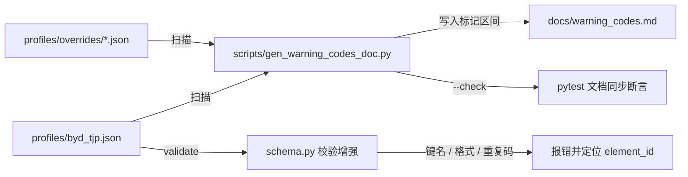

# warning_codes 专项完善计划

日期：2026-10-29 | 状态：待批准

## 背景

[`profiles/byd_tjp.json`](../profiles/byd_tjp.json) 中 42 条 ODC 元素的 [`warning_codes`](../odd_judge/core/types.py:112) 目前无专门文档，码值含义只能靠 `element_id` 反推；存在码值冲突（`PER-CONF-NEAR` 同时挂在摄像头/激光雷达置信度两个元素上）；[`validate_profile_dict()`](../odd_judge/config/schema.py:16) 不校验 `warning_codes` 的键名与重复。

## 范围（已与用户确认）

- ✅ 仅做 warning_codes 专项：**专门文档 + 生成脚本 + validate 校验 + 冲突治理**
- ✅ 允许重命名冲突码值（码值未对外承诺）
- ❌ 不做：JSON Schema 文件、override 字段级 patch、source/unit 字段、element_id 冲突检测

## 交付物

| # | 文件 | 类型 | 内容 |
|---|------|------|------|
| 1 | [`profiles/byd_tjp.json`](../profiles/byd_tjp.json) | 数据修复 | 重命名冲突码值（见下表） |
| 2 | [`odd_judge/config/schema.py`](../odd_judge/config/schema.py) | 校验增强 | `warning_codes` 键名/格式/重复码校验 |
| 3 | `scripts/gen_warning_codes_doc.py` | 新脚本 | 扫描 profiles 生成码表，支持 `--check` 防漂移 |
| 4 | `docs/warning_codes.md` | 新文档 | 命名规范 + 自动码表 + 引擎码附录 |
| 5 | [`tests/test_judge_loader.py`](../tests/test_judge_loader.py) | 测试 | 校验用例 + 文档同步断言 |
| 6 | [`README.md`](../README.md) / [`docs/semantics.md`](../docs/semantics.md) / [`docs/architecture.md`](../docs/architecture.md) | 互链 | 指向 `docs/warning_codes.md` |

## 1. 码值冲突治理（重命名明细）

| 元素 | 字段 | 原值 | 新值 |
|------|------|------|------|
| [`ODC.7.1.3.camera_confidence`](../profiles/byd_tjp.json:482) | `boundary` | `PER-CONF-NEAR` | `PER-CAM-CONF-NEAR` |
| [`ODC.7.1.4.lidar_confidence`](../profiles/byd_tjp.json:494) | `boundary` | `PER-CONF-NEAR` | `PER-LIDAR-CONF-NEAR` |

- `outside` 码 `PER-CONF-001` / `PER-CONF-002` 已可区分，保持不变。
- 库内无代码/测试引用该码值（已全库检索确认），无其他连带修改。

## 2. schema 校验增强（`validate_profile_dict()`）

新增三条规则（均为 error 级，返回错误字符串列表，风格与现有校验一致）：

1. **键名合法性**：`warning_codes` 仅允许 `outside` / `boundary` 两个键（与 [`_warning_code()`](../odd_judge/core/evaluate.py:174) 的消费口径一致，其他键会被静默忽略，须拦截）。
2. **码值格式**：正则 `^[A-Z][A-Z0-9]*(-[A-Z0-9]+)+$`（兼容现有 `ODD-ROAD-TYPE-001`、`SCN-LANE-01`、`ENV-RAIN-002` 等全部存量码）。
3. **重复码检测**：同一 profile 内跨元素去重（`boundary` 与 `outside` 码统一计入），冲突时报出双方 `element_id`。同时在 [`parse_profile()`](../odd_judge/config/loader.py:83) 合并 [`get_extra_elements()`](../odd_judge/config/registry.py:37) 后做同样检测，覆盖插件注册元素引入的冲突。

## 3. 生成脚本 `scripts/gen_warning_codes_doc.py`

- 扫描 `profiles/*.json` 与 `profiles/overrides/*.json`，按 `profile_id` 分组输出码表。
- 仅重写 `docs/warning_codes.md` 中 `<!-- AUTO-GEN:BEGIN -->` / `<!-- AUTO-GEN:END -->` 标记区间，手写章节（命名规范、消费行为说明）不受影响。
- `--check` 模式：重新生成并与现有文件比对，不一致时退出码非 0（供测试/CI 断言文档未漂移）。

## 4. `docs/warning_codes.md` 文档结构

1. 概述：双命名空间（profile 告警码 vs 引擎 `reason_code`）
2. 命名规范：域前缀表（`ODD-`/`SCN-`/`ENV-`/`ILL-`/`DYN-`/`ODC-`/`PER-`/`ENT-`）、`-NEAR` 后缀、序号；说明跳号（`ENV-RAIN-002` 等）沿用 BYD TJP 表 B.x 条目号
3. 自动码表（AUTO-GEN 标记区间）：每码一行 — 告警码 / element_id / label_zh / 触发状态 / 阈值条件 / message_zh
4. 消费行为说明：BOUNDARY 缺 `boundary` 码时回落 `outside` 码（[`evaluate.py:178`](../odd_judge/core/evaluate.py:178)）；`reason_code` 输出位置（[`RuleResult`](../odd_judge/core/types.py:121) → [`aggregate.py`](../odd_judge/core/aggregate.py:53)）
5. 引擎码附录（手写）：`UNDEFINED-REQ`、`UNDEFINED-AS-NOT-ALLOWED`、`UNDEFINED-PERMISSIVE`、`UNDEFINED-STRICT`、`UNDEFINED-DEFAULT`、`CONDITIONAL-SKIP`，及开关跳过 reason（[`api.py`](../odd_judge/api.py:41)）
6. 维护说明：`python scripts/gen_warning_codes_doc.py` 重新生成；`odd-judge validate` 校验

## 5. 测试

- `validate_profile_dict()` 拒绝非法键名（如 `"warn": ...`）
- `validate_profile_dict()` 拒绝重复码（构造两元素同码的坏样例）
- `validate_profile_dict()` 拒绝非法码值格式（小写、空格）
- 现有 [`byd_tjp.json`](../profiles/byd_tjp.json) 校验通过（含重命名后）
- 文档同步：跑 `gen_warning_codes_doc.py --check` 断言退出码为 0

## 工作流

## 验收标准

- `pytest` 全量通过（含新增用例）
- `odd-judge validate --profile byd_tjp` 输出 `VALID`
- `python scripts/gen_warning_codes_doc.py --check` 退出码为 0
- 全库检索 `PER-CONF-NEAR` 无残留（仅出现在文档的变更说明中可接受）
